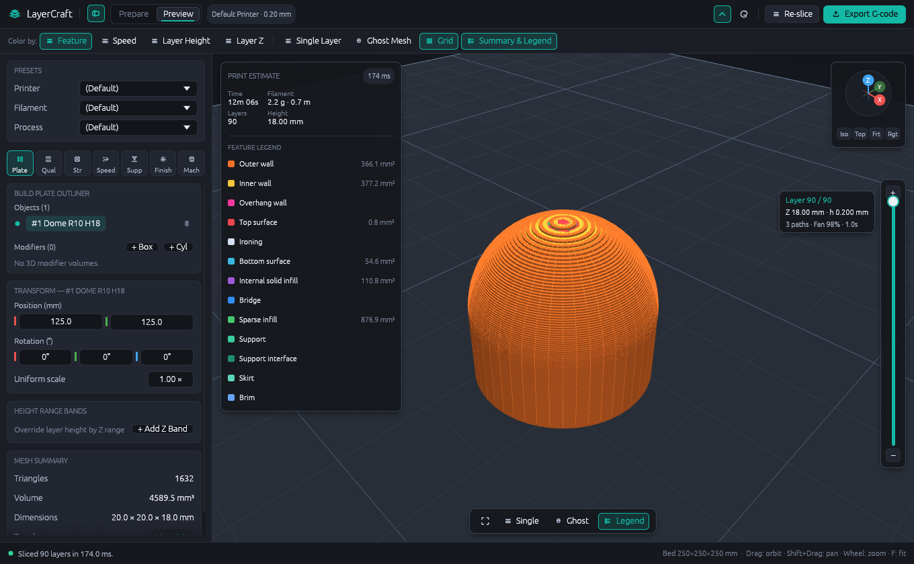
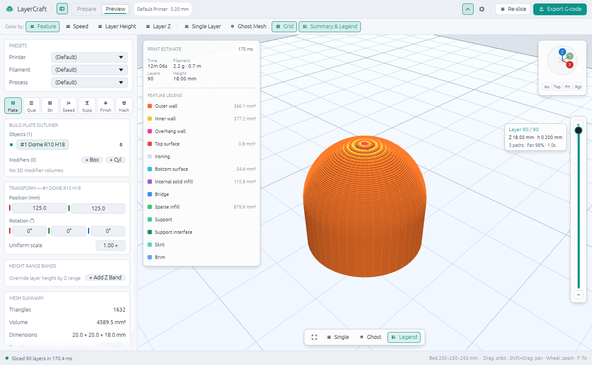

<p align="center">
  
</p>

<h1 align="center">LayerCraft</h1>

<p align="center">
  <strong>An open-source, clean-room 3D printer slicer built in pure Rust — designed from the ground up for both humans and AI agents.</strong><br />
  Slice STL and 3MF meshes with fixed-point geometry, inspect toolpaths visually, verify G-code physics, and let AI agents drive every step through the built-in MCP server. Runs natively on desktop, in the browser via WebAssembly, and headlessly via CLI.
</p>

<p align="center">
  <a href="#built-for-ai-agents-mcp">AI Agents (MCP)</a> ·
  <a href="#what-it-does">Capabilities</a> ·
  <a href="#quick-start">Quick Start</a> ·
  <a href="#architecture--verification">Architecture</a> ·
  <a href="docs/oracle.md">Oracle (6/6)</a> ·
  <a href="docs/ladder.md">Complexity Ladder (43/43)</a> ·
  <a href="ROADMAP.md">Roadmap</a>
</p>

<p align="center">
  <a href="LICENSE-MIT"></a>
  <a href="docs/layers.md"></a>
  <a href="docs/mcp.md"></a>
  <a href="docs/oracle.md"></a>
  <a href="docs/ladder.md"></a>
</p>

<p align="center">
  
</p>

<p align="center">
  <em>LayerCraft Desktop Studio (Dark Studio theme, 4× MSAA <code>wgpu</code> viewport): a 90-layer sliced dome inspected with floating ViewCube navigation, per-feature toolpath coloring, interactive vertical layer scrubbing, and live print metrics.</em>
</p>

| Dark Studio — Prepare | Light Drafting — Preview |
|---|---|
|  |  |
| Build plate setup, hierarchical Plate Outliner, contextual Print / Filament / Supports / Output ribbon, and preset card. | Light Drafting theme inspecting 90-layer toolpaths cleanly against translucent HUD overlays. |

---

## Built for AI Agents (MCP)

A core goal of LayerCraft is making **3D printing workflows first-class for AI agents**. Rather than bolting automation onto a GUI later, every action in LayerCraft goes through a deterministic, schema-typed command engine (`layercraft-engine`) exposed directly over the [Model Context Protocol](https://modelcontextprotocol.io) (`layercraft-cli mcp`).

- **Self-describing command schemas:** Agents query `commands` for JSON input/output schemas across all plate, modifier, profile, slicing, and G-code operations instead of guessing flags or parsing fragile text.
- **Visual closed-loop inspection:** The `screenshot` tool renders the 3D build plate, sliced toolpaths, or individual top-down layers as inline PNG images (`image/png`) so vision-capable agents can spot thin-wall gaps, floating islands, or support placement before exporting.
- **Physical safety verification:** `gcode.evaluate` checks every generated G-code file for non-finite coordinates, out-of-bounds moves, layer continuity, volumetric flow, Z-hops, arcs, and adaptive layer variation.
- **Zero modal dialogs, panic-free errors:** Invalid parameters or malformed meshes return structured errors cleanly (`unwrap`/`expect`/`panic`/`unsafe` are lint-forbidden across non-test code).
- **Natural companion to CAD MCP servers:** Pair LayerCraft with an upstream CAD MCP server (such as [SolidCraft](https://github.com/tangency-labs/solidcraft)) so an agent can generate parametric geometry, load the exported STL/3MF onto LayerCraft's plate, tune settings or modifier volumes, inspect screenshots, and produce verified G-code in one loop.

### Connect in Seconds

Build `layercraft-cli`:

```sh
cargo build --release -p layercraft-cli
```

Register with **Claude Code**:

```sh
claude mcp add layercraft -- /absolute/path/to/layercraft/target/release/layercraft-cli mcp
```

Or add to any MCP client (`Claude Desktop`, `Cursor`, `Antigravity`):

```json
{
  "mcpServers": {
    "layercraft": {
      "command": "/absolute/path/to/layercraft/target/release/layercraft-cli",
      "args": ["mcp"]
    }
  }
}
```

### MCP Tools (`layercraft-mcp`)

| Tool | What the Agent Gets |
|---|---|
| `commands` | Full JSON Schema registry of all `layercraft-engine` commands (`29` commands). |
| `execute` | Execute any plate, modifier, profile, slice, layer, or G-code command in the stateful session. |
| `inspect_plate` | Active `PrintConfig`, merged mesh inspection bounds/volume/manifoldness, `layer_count`, and `gcode_stats`. |
| `inspect_layer` | Per-layer Z height, layer thickness, fan %, estimated print time, region count, and per-role lengths. |
| `screenshot` | Inline base64 `image/png` rendered in `plate`, `preview`, or `layer_top_down` mode with camera & color controls. |

Full MCP setup, parameter schemas, command catalog, and an end-to-end agent walkthrough: **[docs/mcp.md](docs/mcp.md)**.

---

## What It Does

Everything below runs through the same pure-Rust engine across the desktop app, browser app, headless CLI, and MCP server:

- **Fixed-Point `i64` Nanometer Slicing & Wall Generation:** Exact Z-plane triangle slicing, classic perimeter offsetting, and Voronoi medial-axis **Arachne** variable-width walls (`layercraft-clip` + `layercraft-slice`) that eliminate thin-wall gaps and collapses.
- **Surfaces, Infill & Motion Finish:** Top/bottom skin detection, monotonic top/bottom solid fill, Rectilinear, Grid, 3D Gyroid, and 3D Cubic infill patterns, top-surface low-flow monotonic ironing, outer-wall ramped scarf seams, and `G2`/`G3` circular arc fitting.
- **Bridges, Overhangs & Supports:** Anchored bridge orientation and cooling/flow tuning, overhang wall detection and slowdown, **Grid** and **Snug** automatic supports, and model-avoiding branching **Organic Tree** supports with hollow trunks, dense interface layers, and build-plate-only routing.
- **Adaptive Layers & 3D Modifier Volumes:** Curvature-driven adaptive layer heights (`0.08–0.28 mm` and custom schedules), explicit Z height-range bands, physical shell thicknesses, and primitive (`box`/`cylinder`) or arbitrary STL/3MF `Modifier`, `SupportBlocker`, and `SupportEnforcer` volumes.
- **Printer-Ready G-code & JSON Profiles:** `Klipper`, `Marlin`, and Prusa `MarlinBuddy` emitters with volumetric flow capping, pressure/linear advance, per-role acceleration, chamber heating, `M73` progress, and safe `{if}/{elsif}/{else}` + arithmetic macro templates. Includes built-in starter presets (`LayerCraft Generic Klipper 250mm`, `LayerCraft Generic Marlin 220mm`, `LayerCraft CORE One+ HF 0.2mm`, `LayerCraft CORE One+ HF 0.4mm`) and Orca/Bambu-compatible JSON profile inheritance.
- **Studio Desktop App, Browser WASM, CLI & MCP:** Native `eframe` + `4× MSAA` `wgpu` studio with Dark Studio / Light Drafting / System themes, interactive ViewCube & layer scrubber, browser WASM build (`apps/layercraft-web`), headless PNG & G-code CLI, and JSON-RPC 2.0 MCP server.

See [docs/architecture.md](docs/architecture.md) for crate structure and [ROADMAP.md](ROADMAP.md) for completed milestones and upcoming phases (`Phase 5B` real-printer polish, `.3mf` project files, parallel/sweep-line slicing).

---

## Quick Start

### Desktop App

```sh
cargo run --release -p layercraft                                   # desktop studio GUI
cargo run --release -p layercraft -- --sample dome --preview        # launch with sliced sample dome
cargo run --release -p layercraft -- --sample dome --theme light    # Light Drafting theme
cargo run --release -p layercraft -- --sample dome --preview --screenshot preview.png
```

### Headless CLI

```sh
cargo run -p layercraft-cli -- slice part.stl -o part.gcode
cargo run -p layercraft-cli -- profiles
cargo run -p layercraft-cli -- render part.stl -o preview.png --mode preview
cargo run -p layercraft-cli -- eval part.gcode
cargo run -p layercraft-cli -- compare a.gcode b.gcode
cargo run -p layercraft-cli -- commands
cargo run -p layercraft-cli -- mcp
```

### Browser (WASM)

All core crates (`L0`–`L4`), software/GPU viewports, and the shared `egui` studio compile cleanly to `wasm32-unknown-unknown`:

```sh
cd apps/layercraft-web && trunk serve
```

### Verification Gates

```sh
cargo xtask fast   # cargo fmt --check, clippy -D warnings, layers, licences, wasm, unit tests
cargo xtask ci     # fast + analytic/OrcaSlicer oracle + 10-tier complexity ladder
```

---

## Automation Scripts

Any sequence of UI or MCP operations can be saved as a JSON command array and executed headlessly with `layercraft-cli run`:

```json
[
  { "command": "plate.add_sample_shape", "params": { "shape": "bridge_arch" } },
  {
    "command": "profile.apply",
    "params": {
      "machine": "LayerCraft CORE One+ HF 0.4mm",
      "filament": "LayerCraft PLA (0.4mm HF Nozzle)",
      "process": "LayerCraft 0.20mm Balanced (0.4mm HF)",
      "reset_to_defaults": true
    }
  },
  { "command": "slice.run", "params": {} },
  { "command": "gcode.export", "params": {} }
]
```

```sh
cargo run -p layercraft-cli -- run script.json
```

---

## Architecture & Verification

LayerCraft enforces strict architectural seams and automated quality gates via `cargo xtask`:

- **Strict `L0`–`L5` Dependency Layering ([docs/layers.md](docs/layers.md)):** Lower layers never depend on higher layers; UI/GPU crates never appear below `L5`; `layercraft-clip` is the sole 2D geometry kernel seam (`cargo xtask layers`).
- **Permissive-Only Dependencies:** Every shipped crate is audited against an allowlist (`MIT`, `Apache-2.0`, `BSD-*`, `BSL-1.0`, `ISC`, `Zlib`, etc.) and recorded in [THIRD-PARTY-LICENSES.txt](THIRD-PARTY-LICENSES.txt) (`cargo xtask licences --check`).
- **No-Crash Policy:** `unsafe_code = "forbid"` and workspace Clippy lints deny `unwrap`, `expect`, `panic`, and `indexing_slicing` in non-test code.
- **Analytic & Black-Box Oracle ([docs/oracle.md](docs/oracle.md)):** **6 / 6** reference cases validated against closed-form analytic geometry (`tools/oracle-analytic/`) and out-of-process `OrcaSlicer 2.5.2` CLI statistics (`tools/orca-oracle/`).
- **Complexity Ladder ([docs/ladder.md](docs/ladder.md)):** **10 tiers / 43 regression cases** passing from basic calibration primitives (`01-mesh-slice`) through adaptive layer scheduling and 3D modifier volumes (`10-variable-layer-modifiers`).

---

## Clean-Room Policy & Licence

LayerCraft is dual-licensed under **[MIT](LICENSE-MIT) OR [Apache-2.0](LICENSE-APACHE)** and contains **zero GPL, LGPL, or AGPL code**. Contributors and AI agents follow strict [clean-room rules](AGENTS.md) and never read, copy, translate, link, or decompile copyleft slicers (`OrcaSlicer`, `PrusaSlicer`, `BambuStudio`, `CuraEngine`, `Slic3r`) or C++ geometry kernels (`CGAL`, `OpenCASCADE`).

LayerCraft is an independent project and is not affiliated with, sponsored by, or endorsed by any third-party slicer or printer vendor; see [DISCLAIMER.md](DISCLAIMER.md) and [ATTRIBUTION.md](ATTRIBUTION.md).
