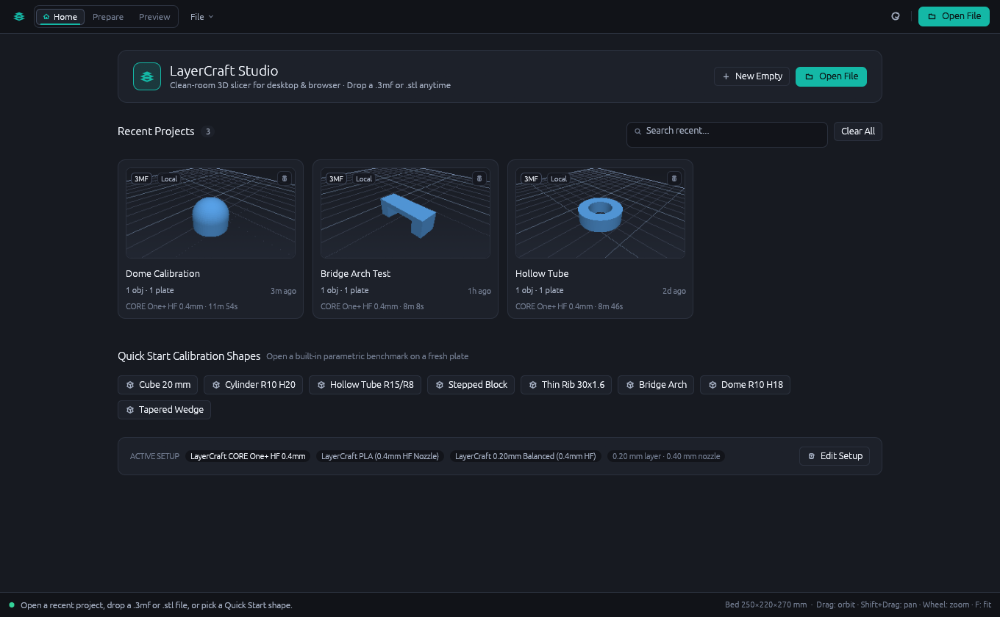
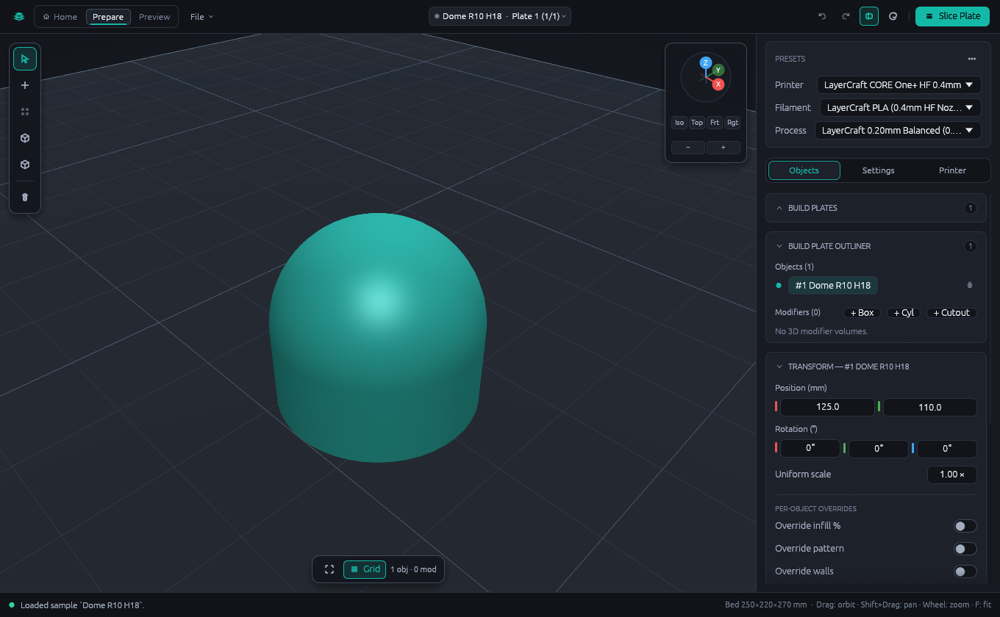

<p align="center">
  
</p>

<h1 align="center">LayerCraft</h1>

<p align="center">
  <strong>An open-source, clean-room 3D printer slicer built in pure Rust — designed from the ground up for both humans and AI agents.</strong><br />
  Slice STL and multi-plate 3MF meshes with fixed-point geometry, repair broken meshes, preview toolpaths and live G-code, upload `.bgcode` directly to LAN printers, and let AI agents drive every step through the built-in MCP server. Runs natively on desktop, in the browser via WebAssembly + Web Workers, and headlessly via CLI.
</p>

<p align="center">
  <a href="#built-for-ai-agents-mcp">AI Agents (MCP)</a> ·
  <a href="#what-it-does">Capabilities</a> ·
  <a href="#quick-start">Quick Start</a> ·
  <a href="#architecture--verification">Architecture</a> ·
  <a href="docs/oracle.md">Oracle (6/6)</a> ·
  <a href="docs/ladder.md">Complexity Ladder (47/47)</a> ·
  <a href="ROADMAP.md">Roadmap</a>
</p>

<p align="center">
  <a href="LICENSE-MIT"></a>
  <a href="docs/layers.md"></a>
  <a href="docs/mcp.md"></a>
  <a href="docs/oracle.md"></a>
  <a href="docs/ladder.md"></a>
</p>

<p align="center">
  
</p>

<p align="center">
  <em>LayerCraft Modern Studio Canvas (Dark Studio theme, 4× MSAA <code>wgpu</code> viewport): a 90-layer sliced dome inspected with GPU-instanced rounded beads, floating ViewCube navigation with zoom controls, filtered Feature Legend + <code>Color by</code> modes, unified move-playback dock, vertical layer scrubber, and right-docked <code>Objects | Settings | Printer</code> inspector.</em>
</p>

| Home — Recent Projects Hub | Dark Studio — Prepare |
|---|---|
|  |  |
| Dedicated startup hub with searchable 3D plate thumbnails (desktop JSON + WASM IndexedDB cache), 8 Quick Start calibration shapes (including Tapered Wedge), and Active Setup summary. | Sleek 44px header with compact Project/Plate selector, left floating tool rail, 4× MSAA build plate canvas with ViewCube zoom controls, and collapsible Outliner & Transform inspector. |

<p align="center">
  
</p>

<p align="center">
  <em>Light Drafting theme inspecting 90-layer toolpaths cleanly against translucent HUD overlays and the right inspector.</em>
</p>

---

## Built for AI Agents (MCP)

A core goal of LayerCraft is making **3D printing workflows first-class for AI agents**. Rather than bolting automation onto a GUI later, every action in LayerCraft goes through a deterministic, schema-typed command engine (`layercraft-engine`) exposed directly over the [Model Context Protocol](https://modelcontextprotocol.io) (`layercraft-cli mcp`).

- **Live Studio connection (or headless on demand):** Launch `layercraft` Studio and run `layercraft-cli mcp` — tool calls attach over local IPC so you can watch the agent load parts, slice, toggle views, and capture `camera: "current"` screenshots directly in the open window (`--connect` to require Studio, `--standalone` for isolated headless CI).
- **Token-efficient discovery, patching & atomic batches:** Agents list concise command summaries (`list_commands`), fetch schemas on demand (`describe_command`), tweak individual fields (`config_patch`), and combine steps safely with rollback (`batch`).
- **Printability & DFM diagnostics:** `analyze_printability` reports overhang risk, detached floating islands, thin-wall collapses, bed adhesion metrics, and per-feature filament/time breakdowns with remediation hints.
- **Visual closed-loop & A/B inspection:** `screenshot` renders `plate`, `preview`, or `layer_top_down` PNGs, while `compare_slices` and `compare_screenshot` compare two configs quantitatively and visually with a 3-panel `A | B | Diff` composite.
- **Direct verified G-code / `.bgcode` export & LAN upload:** `save_gcode` writes `.gcode` or binary `.bgcode` straight to disk and runs physical invariant checks (non-finite values, out-of-bounds moves, layer continuity, volumetric flow, Z-hops, arcs), while `printer_status` and `upload_to_printer` inspect and stream prints to configured LAN printers.
- **Natural companion to CAD MCP servers:** Pair LayerCraft with an upstream CAD MCP server (such as [SolidCraft](https://github.com/tangency-labs/solidcraft)) so an agent can generate parametric geometry, load the exported STL/3MF live onto LayerCraft's plate, tune settings or modifier volumes, inspect screenshots, and produce verified G-code in one loop.

### Connect in Seconds

Build both desktop Studio and CLI (`layercraft-cli mcp`):

```sh
cargo build --release -p layercraft -p layercraft-cli
```

Register with **Claude Code**:

```sh
claude mcp add layercraft -- /absolute/path/to/layercraft/target/release/layercraft-cli mcp
```

Or add to any MCP client (`Claude Desktop`, `Cursor`, `Antigravity`):

```json
{
  "mcpServers": {
    "layercraft": {
      "command": "/absolute/path/to/layercraft/target/release/layercraft-cli",
      "args": ["mcp"]
    }
  }
}
```

### MCP Highlights (`layercraft-mcp`)

18 MCP tools + 4 MCP resources (`layercraft://skill`, `layercraft://plate/summary`, `layercraft://commands`, `layercraft://printers`), including:

| Tool | What the Agent Gets |
|---|---|
| `version` / `set_view` | Check `live_studio` vs `headless` connection state and steer Studio view mode, camera, layer, and color mode. |
| `list_commands` / `describe_command` | Compact schema-on-demand discovery across all **57** `layercraft-engine` commands. |
| `execute` / `batch` / `config_patch` | Run single commands, rollback-safe atomic batches, or partial `PrintConfig` patches. |
| `analyze_printability` | Overhang area, floating islands, thin-wall checks, bed contact ratio, and per-feature filament/time breakdown. |
| `screenshot` / `compare_screenshot` / `compare_slices` | Inline PNG inspection (including live `camera: "current"` + `sync_view`), 3-panel `A \| B \| Diff` renders, and 2D IoU slice diffs. |
| `save_gcode` | Write `.gcode` or binary `.bgcode` directly to disk with built-in physical safety evaluation. |
| `printer_status` / `upload_to_printer` | Query live printer state/temps and upload verified prints directly over LAN (PrusaLink, Prusa Connect Local, OctoPrint, Moonraker). |
| `skill_reference` | Built-in `SKILL.md` workflow and DFM guide (`skills/layercraft/SKILL.md`). |

Full MCP setup, Live Studio flags (`--connect`, `--standalone`, `--socket`), parameter schemas, and agent walkthrough: **[docs/mcp.md](docs/mcp.md)**.

---

## What It Does

Everything below runs through the same pure-Rust engine across the desktop app, browser app, headless CLI, and MCP server:

- **Fixed-Point `i64` Nanometer Slicing & High-Poly Parallel Engine:** Exact Z-plane triangle slicing, classic perimeter offsetting with wall-anchored thin gap fill, hardened Voronoi medial-axis **Arachne** variable-width wall transitions (`layercraft-clip` + `layercraft-slice`), Z-interval triangle bucketing, spatial `MaskClipIndex`, and deterministic multi-threaded desktop slicing + content-hashed browser Web Worker execution.
- **Surfaces, Per-Object Slicing & Motion Finish:** Monotonic/concentric top and bottom skins, Rectilinear, Grid, 3D Gyroid, and 3D Cubic infill, thin gap fill, per-object overrides with `EXCLUDE_OBJECT`/`M486` cancel-object and sequential `ByObject` clearance checks, top-surface low-flow monotonic ironing, outer-wall ramped scarf seams, progressive overhang slowdown, mid-layer fan modulation, scheduled per-Z pause/`M600`/custom G-code events, and `G2`/`G3` circular arc fitting.
- **Bridges, Overhangs & Supports:** Anchored bridge orientation and cooling/flow tuning, overhang wall detection and slowdown, **Grid** and **Snug** automatic supports, and model-avoiding branching **Organic Tree** supports with hollow trunks, overhang corner seeding, continuous dense interface canopies, and build-plate-only routing.
- **Adaptive Layers & 3D Modifier Volumes:** Curvature-driven adaptive layer heights (`0.08–0.28 mm` and custom schedules), explicit Z height-range bands, physical shell thicknesses, and primitive (`box`/`cylinder`) or arbitrary STL/3MF `Modifier`, `SupportBlocker`, `SupportEnforcer`, and `NegativePart` volumes.
- **Multi-Plate `.3mf` Projects, Mesh Repair & DFM Safety:** Full multi-part & multi-plate `.3mf` project import/export, bounded undo/redo history, deterministic STL/3MF mesh repair (`repair_mesh` welding, manifold orientation, and hole filling), live out-of-bounds/overlap plate warnings, and Printability / DFM diagnostics with one-click fixes.
- **Binary G-code (`.bgcode`), Profiles & Direct LAN Upload:** `Klipper`, `Marlin`, and Prusa `MarlinBuddy` emitters with `.bgcode` v1 (Heatshrink/Deflate + PNG/QOI xLCD thumbnails), volumetric flow capping, pressure/linear advance, per-role acceleration, chamber heating, `M73` progress, and `{if}/{elsif}/{else}` macro templates. Includes Prusa CORE One+ HF (`0.2mm`/`0.4mm` + PLA/PETG/ASA/TPU 95A; `5/6` physical validation prints logged in [docs/core-one-signoff.md](docs/core-one-signoff.md)) & generic starter presets, Orca/Bambu JSON profile inheritance, custom user preset saving, and direct LAN upload to `PrusaLink`, `Prusa Connect Local`, `OctoPrint`, and `Moonraker` with OS keychain credential storage.
- **Modern Studio Canvas UI, Recent Projects Hub & Browser WASM:** Native `eframe` + `4× MSAA` `wgpu` studio featuring a startup **Home** hub with searchable 3D plate thumbnails (`recent_projects.json` on desktop, `localStorage` + IndexedDB in WASM) and 8 built-in Quick Start calibration shapes (including **Tapered Wedge**), a 44px top workspace bar, floating `Prepare` tool rail, ViewCube zoom controls (`-`/`+`), right-docked searchable `Objects | Settings | Printer` inspector, 7 `Color by` Preview modes, synchronized virtualized G-code viewer, intra-layer move playback scrubber with 3D nozzle marker, and responsive desktop + mobile/narrow-screen drawer layout in `apps/layercraft-web`.

See [docs/architecture.md](docs/architecture.md) for crate structure, [docs/core-one-signoff.md](docs/core-one-signoff.md) for the Prusa CORE One+ hardware validation checklist (`5/6` logged), and [ROADMAP.md](ROADMAP.md) for completed phases (`0`–`6D`) and post-v1.0 items.

---

## Quick Start

### Desktop App

```sh
cargo run --release -p layercraft                                   # open Studio on Home / Recent Projects hub
cargo run --release -p layercraft -- --sample dome --preview        # launch with sliced sample dome
cargo run --release -p layercraft -- --sample dome --theme light    # Light Drafting theme
cargo run --release -p layercraft -- --home --screenshot home.png   # headless PNG render of Home hub
```

### Headless CLI

```sh
cargo run -p layercraft-cli -- slice part.stl -o part.gcode
cargo run -p layercraft-cli -- slice part.stl -o part.bgcode --binary --repair
cargo run -p layercraft-cli -- repair broken.stl -o fixed.stl
cargo run -p layercraft-cli -- profiles
cargo run -p layercraft-cli -- render part.stl -o preview.png --mode preview
cargo run -p layercraft-cli -- eval part.gcode
cargo run -p layercraft-cli -- compare a.gcode b.gcode
cargo run -p layercraft-cli -- printer test --protocol prusa-link --url http://printer.local --api-key ...
cargo run -p layercraft-cli -- commands
cargo run -p layercraft-cli -- mcp
```

### Browser (WASM)

All core crates (`L0`–`L4`), software/GPU viewports, background `slice_worker` Web Worker slicing, IndexedDB recent projects cache, and the shared `egui` studio compile cleanly to `wasm32-unknown-unknown`:

```sh
cd apps/layercraft-web && trunk serve
```

### Verification Gates

```sh
cargo xtask fast   # cargo fmt --check, clippy -D warnings, layers, licences, wasm, unit tests
cargo xtask ci     # fast + analytic/OrcaSlicer oracle + 11-tier complexity ladder
```

---

## Automation Scripts

Any sequence of UI or MCP operations can be saved as a JSON command array and executed headlessly with `layercraft-cli run`:

```json
[
  { "command": "plate.add_sample_shape", "params": { "shape": "bridge_arch" } },
  {
    "command": "profile.apply",
    "params": {
      "machine": "LayerCraft CORE One+ HF 0.4mm",
      "filament": "LayerCraft PLA (0.4mm HF Nozzle)",
      "process": "LayerCraft 0.20mm Balanced (0.4mm HF)",
      "reset_to_defaults": true
    }
  },
  { "command": "slice.run", "params": {} },
  { "command": "gcode.export", "params": {} }
]
```

```sh
cargo run -p layercraft-cli -- run script.json
```

---

## Architecture & Verification

LayerCraft enforces strict architectural seams and automated quality gates via `cargo xtask`:

- **Strict `L0`–`L5` Dependency Layering ([docs/layers.md](docs/layers.md)):** Lower layers never depend on higher layers; UI/GPU crates never appear below `L5`; `layercraft-clip` is the sole 2D geometry kernel seam (`cargo xtask layers`).
- **Permissive-Only Dependencies:** Every shipped crate is audited against an allowlist (`MIT`, `Apache-2.0`, `BSD-*`, `BSL-1.0`, `ISC`, `Zlib`, etc.) and recorded in [THIRD-PARTY-LICENSES.txt](THIRD-PARTY-LICENSES.txt) (`cargo xtask licences --check`).
- **No-Crash Policy:** `unsafe_code = "forbid"` and workspace Clippy lints deny `unwrap`, `expect`, `panic`, and `indexing_slicing` in non-test code.
- **Analytic & Black-Box Oracle ([docs/oracle.md](docs/oracle.md)):** **6 / 6** reference cases validated against closed-form analytic geometry (`tools/oracle-analytic/`) and out-of-process `OrcaSlicer 2.5.2` CLI statistics (`tools/orca-oracle/`).
- **Complexity Ladder ([docs/ladder.md](docs/ladder.md)):** **11 tiers / 47 regression cases** passing from basic calibration primitives (`01-mesh-slice`) through dimensional compensations, combing, and embedded thumbnails (`11-real-printer-polish`).

---

## Clean-Room Policy & Licence

LayerCraft is dual-licensed under **[MIT](LICENSE-MIT) OR [Apache-2.0](LICENSE-APACHE)** and contains **zero GPL, LGPL, or AGPL code**. Contributors and AI agents follow strict [clean-room rules](AGENTS.md) and never read, copy, translate, link, or decompile copyleft slicers (`OrcaSlicer`, `PrusaSlicer`, `BambuStudio`, `CuraEngine`, `Slic3r`) or C++ geometry kernels (`CGAL`, `OpenCASCADE`).

LayerCraft is an independent project and is not affiliated with, sponsored by, or endorsed by any third-party slicer or printer vendor; see [DISCLAIMER.md](DISCLAIMER.md) and [ATTRIBUTION.md](ATTRIBUTION.md).
